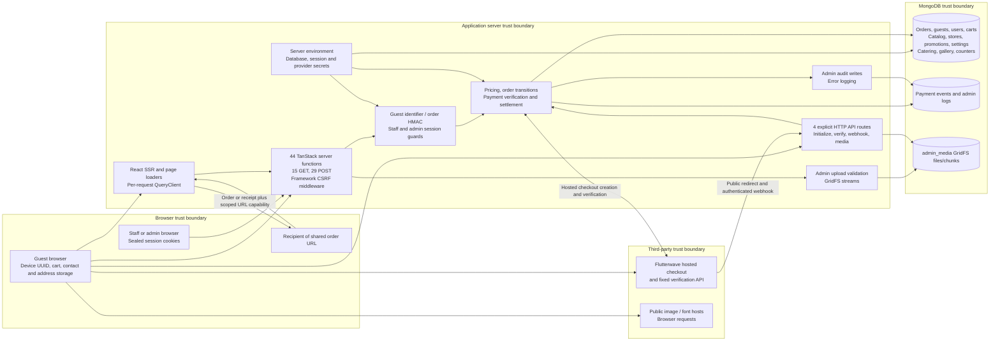

# Application threat model

**Assessment date:** 2026-11-25. **System:** Grill & Swill restaurant storefront and operations application. **Evidence basis:** repository source, available Git history, dependency/configuration inspection, isolated synthetic tests, and direct invocation of a credential-free production build's request handler. This model describes observed application behavior and conditional deployment threats; it does not attest to deployed cloud, database or payment-provider controls.

## System and intended security properties

The primary application uses React 19, TypeScript, TanStack Start/Router/Query, Vite, Nitro and the MongoDB native Node driver. The build selects Nitro's Vercel Node preset when `VERCEL=1`, otherwise `node-server`. Lovable manages integration/generated files and schema resources; its configuration wrapper participates in the build. Hosting settings and deployed policies were not accessed.

Guests browse a public catalog, store directory, promotions, catering packages and gallery. A browser-generated device UUID associates remote carts, order history and reward balances. Hosted Flutterwave checkout takes payment; the application stores delivery/contact data and receipt/order snapshots. A signed URL capability is intended to share read access to one order and receipt. Kitchen staff use one shared passcode and a sealed staff session. Administrators use a distinct shared passcode and sealed admin session for catalog, orders, customer reports, promotions, settings, catering and media.

Security properties that the application should enforce:

1. A guest's device identity cannot be asserted by another caller merely by knowing its UUID. Cart writes, private history, reward redemption and checkout must derive ownership from a verified guest proof.
2. A shared order capability grants only its documented order/receipt access. Sharing it must not unlock other orders, the underlying guest account or cart mutation.
3. Creating, viewing and settling a payment are separate permissions. Provider verification establishes payment authenticity; it does not establish that the browser caller owns the order.
4. Only positively verified payment can authorize ordinary fulfillment and reward issuance. Public or legacy endpoints must satisfy the same invariant as active checkout.
5. Payment attempts, discounts and reward consumption remain valid under retries, delayed callbacks, duplicate events and concurrent checkouts. A customer charge must be reconcilable to its order.
6. Staff and administrator rights remain distinct, are attributable where practical and can be revoked. Credential changes/logout must invalidate compromised sessions according to an explicit policy.
7. Secrets do not enter Git history, browser bundles, logs or reports. Previously exposed credentials are considered compromised until rotated and deployment reuse is checked.
8. Public input, uploads and third-party responses cannot inject queries/code, cross privileged boundaries or consume unbounded resources. Sensitive responses and shared URLs receive deliberate retention/cache protections.

## Assets and security priorities

| Asset | Stored or processed location | Security objective and consequences |
|---|---|---|
| Customer identity/contact and delivery data | `orders`, `users`, catering inquiries; browser address/contact storage; SSR/RPC responses | Confidentiality and correct ownership. Exposure reveals email, phone, address, instructions and purchase history. |
| Order and receipt snapshots | `orders`; tracking/receipt pages | Correct price, ownership, fulfillment state and durable historical integrity. |
| Payment credentials and webhook hash | Server environment | Prevent unauthorized merchant operations and forged integration traffic. Real credential validity was not tested. |
| Payment references, transaction IDs and checkout links | Orders, events, callbacks, provider requests | Correct attempt/order binding. Identifiers must not become unintended credentials for private data. |
| Rewards and promotion usage | `guests`, `promotions`, pending/paid orders | Avoid unauthorized redemption, overcommit and reward creation without payment. |
| Staff/admin sessions and passcodes | Server environment; sealed cookies; h3 session transport | Protect global operations and customer data; revoke captured sessions and limit guessing. |
| `SESSION_SECRET` | Server environment and historical exposure evidence | Integrity/confidentiality of both privileged session seals and order HMACs. Reuse increases compromise scope. |
| MongoDB credential/principal and connection URI | Server environment; historical exposure evidence | Prevent direct database access, data theft or mutation subject to actual network/role restrictions. |
| Catalog, prices, store configuration and fulfillment queue | Menu/categories/stores/settings/orders | Prevent unauthorized business changes and unpaid fulfillment. |
| Admin media and gallery interaction | GridFS, gallery items/comments/likes | Safe type/size handling; intended publication and deletion/retention; spam resistance. |
| Source, dependencies and build/deployment credentials | Git, lockfiles, package registry/build environment, Lovable/host | Protect software integrity and prevent stolen credentials persisting through clones, history and artefacts. |
| Security logs and evidence | `admin_logs`, application logging, audit directory | Support incident investigation without exposing credentials or unnecessary PII. |

## Architecture and data flow

The diagram separates browser-controlled input, application authority, persistent state and provider authority. Arrows identify logical data flows; HTTPS/TLS and hosting controls are expected deployment properties rather than tested network claims.

The source database inventory includes `menu_items`, `categories`, `stores`, `carts`, `guests`, `users`, `orders`, `counters`, `admin_logs`, `site_settings`, `promotions`, `catering_packages`, `catering_proteins`, `catering_inquiries`, `gallery_items`, `gallery_likes`, `gallery_comments`, `payment_events`, and `admin_media.files/chunks`. There is no active Mongoose or GraphQL model. Mongo transactions are required for order/payment operations. Index creation occurs on connection.

A nested `my-mongodb-app/` is a separate Next.js/MongoDB example, with a public database-ping server action and two page entry points. It is included in dependency and source review; it is not imported by the primary server. PostgreSQL/Drizzle schema/migration resources and generated Supabase/OAuth/cron helper code remain in the repository, but no active primary request path through those integrations was found. No active queue, scheduled reconciliation worker, outgoing mail sender, AI call or Stripe payment path was identified. Presence of an SDK/schema alone does not imply an active privileged service.

## Entry points and attack surface

The source and production resolver agree on **44 server-function entries: 15 GET and 29 POST**. Their transport uses build-specific identifiers under the framework server-function prefix; knowledge of a function identifier confers no authorization, and an unused UI caller does not prove the function is absent from the build. There are **4 explicit HTTP API routes**, **13 application page routes** plus the root layout, and the separately scoped Next example.

| Surface | Entry points / exposed behavior | Authority and checks |
|---|---|---|
| Public discovery | Catalog/categories/stores/settings/promotions/catering/gallery reads | Public bounded DTOs/queries; fallback content for optional data. |
| Guest state | `getCart`, `saveCart`, `getGuestRewards`; ordinary checkout initialization | Caller-supplied guest UUID currently acts as owner identity. Input type validation does not prove ownership. |
| Shared order data | `getOrder`, `/orders/:id`, `/receipts/:id` | HMAC bound to order+guest; full order response currently exposes internal guest/payment properties. |
| Operator authentication | Session-state, unlock and lock functions for kitchen/admin | Shared configured passcodes; h3 sealed cookies and backend role flags; no server revocation store or application login throttle. |
| Staff actions | Kitchen queue, order transition, item availability | Explicit staff guard; legacy provider-absent orders remain fulfillable. |
| Admin actions | Workspace and sales read; menu/category/store/settings/promo/catering/gallery/order mutations; upload | Explicit administrator guard; broad global operational access, shared credential attribution. |
| Anonymous persistent interactions | Gallery likes/comments and catering requests | UUID/type validation; guest-key quotas for comments/inquiries, vulnerable to identity rotation and concurrent creation. |
| Legacy checkout | Compiled `placeOrder` server function | Public, no provider charge, immediately credits rewards and creates fulfillable records. Confirmed in compiled handler tests. |
| `POST /api/payments/initialize` | Public guest order/contact/body, same-origin JSON route | Server pricing/availability/totals; provider checkout allowlist; post-buffer body limit; no verified guest proof or request throttle. |
| `GET /api/payments/verify` | Numeric transaction ID and optional ref/order/status | Provider verification for transaction path; no browser owner/continuation proof; unsigned status path can persist state. |
| `POST /api/webhooks/flutterwave` | Provider static hash plus event/transaction/status JSON | Timing-safe hash check before DB/body; independent verification; event dedupe; pending-result and stale-claim weaknesses. |
| `GET /api/media/:id` | Public 24-hex file ID | Admin-image kind and JPEG/PNG/WebP stored MIME; `nosniff`; public immutable cache. Publication does not govern file access. |
| Build/runtime configuration | Package install/build, environment loading, dependency graph, Git history | Secrets/locking/supply-chain boundaries; `.env.local` auto-loading requires care during tests and local startup. |

Detailed methods, inputs, schemas, queries and response behaviors are recorded in [API_FUNCTION_INVENTORY.md](agent-backend/API_FUNCTION_INVENTORY.md) and the [payments/API assessment](agent-payments/ASSESSMENT.md). The compiled inventory is [session-built-function-inventory.json](evidence/session-built-function-inventory.json).

## Trust and privilege boundaries

| Boundary | Untrusted material | Required authority / observed condition |
|---|---|---|
| Browser to server | UUIDs, item selections, quantities, client totals, contact/address, promo/reward requests, role claims | Zod validation, server prices and role guards are present. Guest UUID ownership is not verified; frontend visibility is irrelevant. |
| Origin to RPC | Cross-origin GET/POST or browser-triggered calls | Framework CSRF applies to server functions; initialization has its own Origin/JSON check. CSRF does not prevent a direct anonymous attacker request or guest BOLA. |
| Share recipient to guest owner | One order URL/HMAC | Order-scoped access should stop here; full response leaks guest identity and history endpoint issues other order capabilities. |
| Anonymous to staff/admin | Passcode submission or copied seal | Cryptographic seals/roles resist tampering; historical signing secret reuse and valid-cookie replay threaten this boundary. |
| Staff to administrator | Staff session, role-like payload fields | Separate role/session flags prevent ordinary vertical escalation. Shared `SESSION_SECRET` compromise would affect both cryptographic domains. |
| Application to database | Query filters, writes, index setup, transaction effects | Server constructs filters from validated scalar inputs. Database principal roles, network ACLs, backups and deployed TLS settings remain unverified. |
| Checkout to provider | Server amount/currency/order/reference; hosted URL response | Fixed API origin, 25s timeout, trusted checkout destination validation. Caller totals are rechecked; provider credential stays server-side. |
| Provider callback to merchant state | Browser query strings and provider event body | Redirect status is untrusted; webhook hash and API re-verification are distinct checks. A verified transaction does not authenticate the callback caller. |
| Pending to paid / fulfillment | Verified provider outcome, reward/promo/attempt state | Paid transition and effects are transactional. Reward/coupon reservations and durable attempt/event reconciliation are incomplete. Legacy no-provider records bypass positive payment gating. |
| Admin upload to public storage | Base64 file bytes and claimed MIME | Admin guard, size/type/signature checks, generated IDs, no archive/execution sink. All eligible files are publicly readable independently of gallery publication. |
| Runtime to logs/telemetry | Errors, provider messages, action details, customer context | Public error pages are generic. Full server errors/causes are logged without a common redaction boundary; admin actions lack individual actor identity. No live secret-log leakage was demonstrated. |
| Repository to deployment | Historical secrets, lockfile/dependency content, build plugins | Current placeholder files do not revoke historical credentials. Local equality with historical signing/admin/DB values was confirmed without using credentials; deployment reuse is unknown. |

## Threat actors

- An anonymous remote caller can invoke exposed APIs/server functions without following storefront UI. They can choose their own UUIDs, send bounded malformed input and repeatedly attempt business workflows.
- A legitimate guest can manipulate their own checkout or obtain identifiers from their own provider transaction, and may attempt unauthorized access to another guest when an identifier is disclosed.
- A recipient of a shared order/receipt URL has a valid read capability for one order. The application must enforce that scope even if the recipient is adversarial.
- A repository reader, former collaborator, clone holder or build-log reader may possess historical credentials. They can exploit unchanged deployment secrets only where those values remain in use; this audit did not test live validity.
- A holder of a captured valid staff/admin seal may replay it. Cookie capture itself was not demonstrated; logout/passcode-change revocation was tested separately.
- A malicious website can attempt cross-site requests or link embedding; installed CSRF and cookie controls mitigate parts of this threat. Browser/TLS/CDN behavior was not actively tested.
- A compromised operator can use already-authorized global functions, upload media or change business configuration. Individual attribution, least privilege and revocation matter even when function-level guards work.
- A compromised dependency/build plugin or externally managed integration can affect code/credentials within its configured authority. This is a supply-chain threat; no malicious package was identified or executed for this assessment.
- An unreliable or delayed provider can send duplicate/out-of-order events or expose eventual-consistency windows without malicious intent. Security-critical commerce state must remain correct under those conditions.

## Concrete threat scenarios and evidence

| Scenario | Path and preconditions | Consequence / evidence / status |
|---|---|---|
| Historical signing credential is reused | A Git-history reader recovers an exposed `SESSION_SECRET`; target deployment still uses it. Current local value equals historical literal; deployment equality is unknown. | The secret underpins order HMACs and operator seals, so reuse can enable forged authority and private-data access. Exposure/reuse in local configuration confirmed by [redacted secret review](agent-supply/secret-review.json); production exploitation was not attempted. |
| Historical admin or DB credential is reused | Former collaborator/history reader obtains exposed admin passcode or credential-bearing Mongo URI; deployment or database principal remains active. | Admin access or direct database access within actual network/principal privileges. Local equality is confirmed; remote validity, IAM, network reachability and permission scope are unverified. [Validation evidence](agent-supply/secret-validation.json) contains metadata only. |
| Shared receipt becomes guest-wide access | Recipient reads one valid order, extracts `guest_id`, invokes anonymous rewards/history endpoint, receives second-order capability, then reads or overwrites cart by ID. | Confirmed private history/contact/ownership escalation with source and compiled production handler using synthetic records. [Backend review](agent-backend/BACKEND_REVIEW.md), [compiled checks](evidence/session-built-handler-results.json). |
| Merchant transaction ID becomes private order access | Caller knows/discovers a numeric merchant transaction ID and calls verification without `tx_ref`, order ID or guest/continuation proof. | Provider validates payment; callback mints valid private order capability for caller. Confirmed with mocked provider; practical guessing rates/provider ID sequencing are unverified. [Payment tests](agent-payments/test-results.json). |
| Public legacy checkout earns rewards/fulfillment without payment | Attacker invokes compiled `placeOrder` with syntactically valid synthetic checkout and demo last-four value. | Uncharged provider-absent order, immediate reward credit, kitchen visibility. Confirmed through real compiled middleware/serialization, without live DB or charge. [Compiled checks](evidence/session-built-handler-results.json). |
| Multiple pending checkouts overcommit one reward balance | Guest creates two valid pending checkouts before either settles; each uses same available balance. | Both pay discounted amount; settlement clamps insufficient balance rather than refusing/reserving. Confirmed isolated sequential overcommit, not live concurrent DB transactions. [Boundary suite](tests/backend-boundaries.test.ts). |
| Limited-use promotion is applied to excess paid orders | Two checkouts snapshot available coupon capacity before settlement increments usage. | Coupon usage limit exceeded after both paid orders finalize; server pricing is correct individually but the global business invariant fails. Confirmed synthetic flow. [Boundary suite](tests/backend-boundaries.test.ts). |
| Pending payment is cancelled with unsigned callback | Caller knows random target transaction reference and sends status-only GET without transaction ID. | Persistent pending order/payment status changes without provider/session checks. Already-paid order protected. Confirmed isolated request; random-reference guessing not claimed. [Payments assessment](agent-payments/ASSESSMENT.md). |
| Late charge loses its order or attempt binding | Checkout expires/retries and overwrites only reference; earlier hosted attempt succeeds later, or reference changes during verification/settlement. | Lost charge-to-order reconciliation or inconsistent ref/transaction binding. Confirmed mock delay/interleaving; no real charges performed. [Payments tests](agent-payments/payments-boundaries.test.ts). |
| Successful event is acknowledged while provider still pending | Authentic successful event arrives before verification API reaches paid state; identical event is later retried. | Event marked processed/200 prevents re-verification and order remains pending. Confirmed mocked provider-consistency failure; production occurrence unknown. [Payment results](agent-payments/test-results.json). |
| Replayed privileged seal survives supposed revocation | Attacker possesses valid captured seal before logout or shared passcode rotation. | Seal remains authentic until fixed expiry/global signing rotation; actual h3 cryptography confirms replay behavior. Cookie theft not demonstrated. [Backend test results](agent-backend/test-results.json). |
| Weak operator credential is guessed | Short production staff code or reused/known passcode; no deployed edge throttle. | Global staff access and operational/PII exposure. Source accepts short staff code and lacks login throttle; configured production entropy and edge policy unknown. [Backend review](agent-backend/BACKEND_REVIEW.md). |
| UUID rotation or concurrency bypasses interaction quotas | Anonymous guest rotates caller-selected UUID or submits small concurrent batch before count/write completes. | Persistent gallery/catering spam, like manipulation and resource/admin workload. Confirmed bounded synthetic batches; no availability stress test. [Backend results](agent-backend/test-results.json). |
| Public media outlives publication/deletion | Admin uploads image, withholds/unpublishes/deletes gallery record, but file URL remains known. | Image remains publicly served/cacheable. Confirmed behavior; confidentiality/retention issue depends on product requirements. No private customer upload storage exists. [Media tests](agent-payments/media-boundaries.test.ts). |
| Logging/data-retention permits secondary exposure | Full errors contain sensitive context, shared URL is logged/cached, or device retains address/contact. | Conditional privacy/incident-response risk. Source-level lack of common redaction/retention controls observed; actual secret leakage, browser referrer exposure and deployed log ACLs are unverified. |

## Existing defenses and what they establish

**Backend role enforcement:** Administrator mutations and sales reads enforce admin sessions; kitchen mutations enforce staff sessions. Separate role flags/cookie names reject ordinary cross-role use and client-supplied role claims. Actual h3 tests rejected tampered/expired seals and staff-to-admin transplantation. These controls do not compensate for a compromised signing secret or copied valid seal without revocation.

**Request and response controls:** The compiled production handler rejected cross-site server-function POST and private GET with 403, wrong-origin payment initialization with 403, malformed payment JSON with 400, unsigned webhook with 401 and invalid media traversal identifier with 404. Synthetic admin login emitted `HttpOnly`, `Secure`, `SameSite=Strict` attributes. Unknown function returned a generic failure page without source paths/stack. The 15 checks all passed; some assertions demonstrate vulnerabilities and are not evidence that the application is secure. [Current compiled-handler evidence](evidence/session-built-handler-results.json).

**Input and injection controls:** Important identifiers/fields pass Zod schemas; privileged writes use strict objects; Mongo operators are constructed by server code rather than accepted as arbitrary user filters. No confirmed Mongo/SQL/command injection was found in reviewed active source. This does not prove every possible encoding/parser condition or database principal configuration is safe.

**Pricing and payment authenticity:** Server recomputes menu availability/options/totals, checks exact amount/USD, re-fetches provider transactions and compares transaction ID, reference, amount, currency, customer email and metadata order ID when present. The provider API URL is fixed; encoded numeric ID resists path injection; hosted redirect validation rejects wrong hosts, protocols, userinfo, ports and paths. Transactional paid/effects logic and uniqueness/ownership checks mitigate duplicate reward issuance on replay. These properties do not provide guest ownership or reward/coupon reservation across distinct pending orders.

**Storage/output controls:** Upload role/type/signature/size tests pass; filenames/ObjectIds are generated; media responses use allowlisted MIME plus `nosniff`; no archive extraction/execution sink exists. React escapes public comment/caption/order text. The chart raw-style sink has no user-controlled consuming path in this repository and is not classified as a confirmed XSS vulnerability. SSR QueryClient is per request, reducing cross-request cached-data leakage. Static error pages show generic messages.

**Database/runtime controls:** Cached Mongo client limits pool size to ten and applies connection/server-selection/socket timeouts. Required unique indexes protect IDs, menu slugs, receipt/order numbers, checkout request identity, provider events, promotion codes and gallery likes. Transactions cover payment settlement. Driver/SRV defaults may enable TLS; absence of application `tls: true` is not proof of plaintext transport.

## Remaining risk and design decisions

Immediate risk reduction depends on rotating exposed signing/admin/database credentials through the managed secret/provider workflow and checking all deployed environments, resolving guest ownership/capability scope and eliminating production legacy unpaid checkout. Do not use credential validity checks against external systems without authorization. Preserve published Lovable history; removing current literals does not remove old exposure or revoke credentials. Any exceptional history cleanup requires a separate coordinated decision, not an audit action.

Before production, define server-issued guest identity, scoped/expiring/revocable share links, operator session revocation and individual operator accounts, and durable payment attempts plus reward/promotion reservations and reconciliation. Keep guest checkout and legitimate fulfillment intact. Global signing-secret rotation may invalidate operator cookies and existing order links; plan owner access restoration without reviving compromised capabilities.

High-priority hardening includes persistent rate limits using trusted network identity plus verified guest/operator state; bounded streaming request parsing; security events with actor IDs/redaction; explicit private-response/cache/referrer policies; upload publication/deletion/retention rules; and dependency advisory validation with a reproducible dependency inventory. A unit or build pass alone does not close these risks.

The following deployed controls remain outside verified evidence: MongoDB/Atlas principal roles, IP allowlists/TLS/encryption/backup restore and retention; Vercel/host TLS/CDN/WAF/headers/IAM; actual production secrets/entropy; CI secret access; provider sandbox verification/webhook behavior; browser execution/XSS/referrer/cache behavior; distributed transaction races; and recovery procedures. Existing generated Supabase/Drizzle resources should be assessed through their managed workflow if reactivated.

## Test boundaries and validation quality

Authorization was limited to defensive repository review, read-only scans, isolated synthetic tests and local application behavior. No production/customer record, payment, email, notification, account lock, cloud policy or published Git history was modified. No recovered credential was used to authenticate or probe a third party.

The strongest runtime evidence is direct invocation of the credential-free compiled request handler with framework middleware/serialization and process-local synthetic Mongo state. **No TCP listener, browser-based DAST, ZAP, real MongoDB instance or payment-provider transaction was used for those 15 checks.** Separate suites use actual h3 seal cryptography or reviewed mocks; mock limitations are recorded. Low-count concurrency tests and small parser cases cannot establish denial-of-service resilience or distributed Mongo semantics.

Evidence is deliberately redacted. [Backend review](agent-backend/BACKEND_REVIEW.md), [payment review](agent-payments/ASSESSMENT.md), [secret scan metadata](agent-supply/secret-review.json), [secret configuration validation](agent-supply/secret-validation.json), [compiled handler checks](evidence/session-built-handler-results.json) and the [main security report](SECURITY_AUDIT_REPORT.md) support the scenarios. Current report findings and remediation priorities are maintained in [SECURITY_FINDINGS.md](SECURITY_FINDINGS.md) and [SECURITY_REMEDIATION_PLAN.md](SECURITY_REMEDIATION_PLAN.md). Unverified deployment assumptions must remain explicit until tested with appropriate authorized access.
